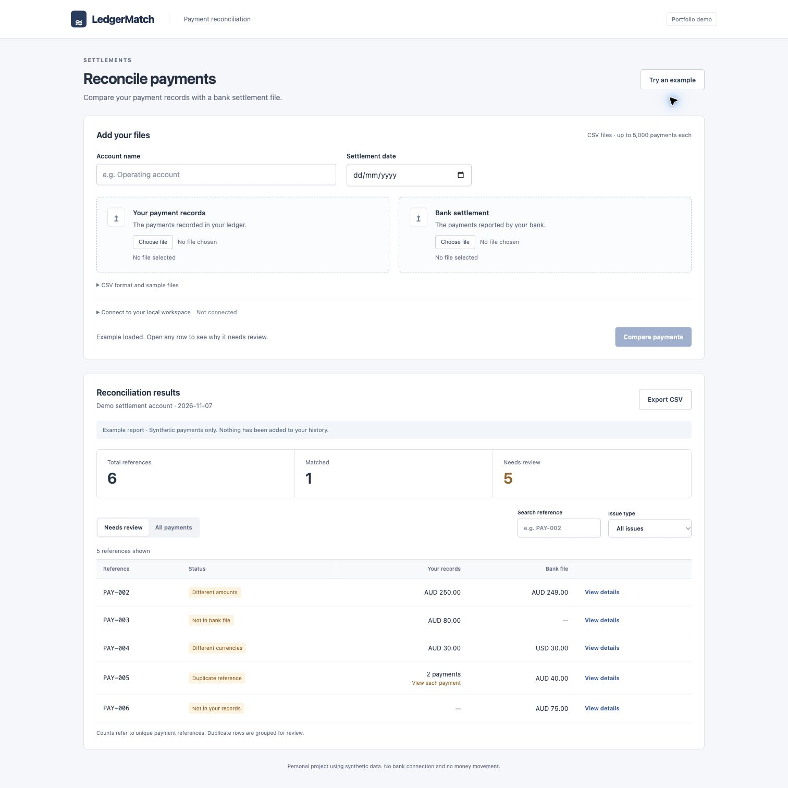
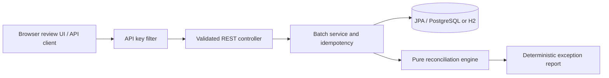

# LedgerMatch

A Java Spring Boot payment reconciliation service. Compare an internal ledger with bank settlement data and review the exceptions instead of checking every payment by hand.

**Personal portfolio project.** Uses synthetic data, never initiates payments, and is not affiliated with a bank or investment platform. Built with AI coding assistance; the implementation, tests and design notes are available for review.



## The problem

A payment may appear in an internal ledger but not a settlement file. A file might contain the same reference twice, the wrong amount, or a different currency. A spreadsheet comparison can hide duplicates or accidentally compare amounts across currencies. LedgerMatch makes these cases explicit and keeps the submitted batch for later review.

The included sample contains six references: one match, one missing bank payment, one missing ledger payment, one amount mismatch, one currency mismatch and one duplicate reference.

## What it does

- REST API to submit, retrieve and list settlement batches.
- Deterministic reference matching, with all input rows preserved in the report.
- `BigDecimal` money comparisons; `10.0` and `10.00` match without floating-point rounding.
- Duplicate references are exceptions, never silently merged or summed.
- Persistent batches with Spring Data JPA and Flyway schema migrations.
- PostgreSQL configuration for Docker Compose and CI; file-backed H2 for local development.
- Idempotency keys with a database uniqueness constraint and conflict handling for concurrent retries.
- Validated nested input and consistent HTTP problem responses.
- Shared API-key protection for data endpoints and metrics; public liveness/readiness summary.
- Actuator health, Prometheus metrics, paginated history and a CSV upload interface with previews, issue filters, payment details and spreadsheet export.
- Unit and API/database integration tests, plus GitHub Actions running against PostgreSQL.

## Run locally

Requires Java 17+. Maven is downloaded by the checked-in wrapper.

```sh
export LEDGERMATCH_API_KEY=local-demo-key-change-me
./mvnw verify
./mvnw spring-boot:run
```

Open **http://127.0.0.1:8080** and choose **Try an example**. No access key is needed to view the read-only sample report.

For your own synthetic files, enter an account name and date, choose the ledger and bank CSVs, check the previews, and compare. Open **Connect to your local workspace** to supply the configured access key. Sample CSV downloads and a format guide are included in the form. Results support search, issue filters, payment details and CSV export.

Data is stored in `data/` (excluded from Git). The server key is required at startup, and the browser keeps it in memory only for the session.

### PostgreSQL and containers

Requires Docker Compose:

```sh
cp .env.example .env
# Replace the local-only example credentials in .env.
docker compose up --build
```

Compose waits for PostgreSQL readiness and binds the app to localhost. Flyway creates the schema; Hibernate validates it. The app container runs as a non-root user. To remove demo database contents intentionally, use `docker compose down --volumes`.

## API example

```sh
curl -i http://127.0.0.1:8080/api/batches \
  -H "X-API-Key: $LEDGERMATCH_API_KEY" \
  -H 'Idempotency-Key: demo-settlement-001' \
  -H 'Content-Type: application/json' \
  --data-binary @examples/demo.json
```

A new batch returns `201 Created` and a `Location` header. Submit the same key and parsed payload again to receive `200 OK` with the original batch ID. Reuse the key with different content to receive `409 Conflict`. Keys are scoped to this single-tenant application.

| Method | Path | Purpose |
|---|---|---|
| POST | `/api/batches` | Validate, store and reconcile a batch |
| GET | `/api/batches/{uuid}` | Retrieve its reconciliation report |
| GET | `/api/batches?page=0&size=20` | Browse history; size 1–100 |
| GET | `/demo/report` | Public synthetic example, with no database writes |
| GET | `/actuator/health` | Public summary, with no database details |
| GET | `/actuator/prometheus` | Protected metrics including batch/exception counters |

All `/api/` requests require `X-API-Key`. POST also requires `Idempotency-Key` (1–100 letters, digits, dots, underscores or hyphens). See [API contract](docs/api.md) for the input shape, validation and outcome rules.

## Tests

```sh
./mvnw verify
```

By default tests use an isolated in-memory H2 database. CI sets `TEST_DATABASE_URL`, `TEST_DATABASE_USER` and `TEST_DATABASE_PASSWORD` to run the same integration suite against a PostgreSQL service. Run `node --test tests/csv.test.mjs` for the CSV import/export suite (Node 18+). It covers quoted fields, BOM/CRLF, duplicate preservation, validation, row limits and spreadsheet formula escaping. CI runs both suites.

Backend tests cover all six outcomes, currency priority, decimal precision, input validation, authentication, pagination, persistence, replay conflicts and concurrent retries.

## Architecture



A modular monolith keeps matching logic independent of HTTP and storage. There is no external bank connection or network dependency in reconciliation. Reports are recomputed from the immutable stored submission with the current engine rules. This makes the implementation small, but an engine change could alter a historical report; a versioned report snapshot would be needed for audit-grade use.

## Trade-offs and boundaries

- Exact, case-sensitive reference matching within one account/date batch. No fuzzy matching, partial settlements, FX conversion, fees, reversals or netting.
- Positive amounts only, with two fractional digits maximum. Currencies with other minor-unit conventions are outside this demo's money model.
- A shared key is a demo access boundary, **not** user identity or account-level authorisation. It is unsuitable for real financial records without tenant isolation, proper identity, HTTPS, key rotation, retention controls and access auditing.
- The request is synchronous and bounded to 5,000 entries per source. A large-file system would need streamed ingestion, background jobs and backpressure.
- Fingerprints use the serialised parsed submission. List order, account whitespace and decimal scale are significant for idempotency. Equivalent inputs reordered by the caller require a new key.
- Application metrics are process-local and reset on restart; they are not an accounting ledger. No real production load, availability or security certification is claimed.

See [design decisions](docs/design.md), [operations notes](docs/operations.md) and the source tests for implementation details.

For a five-minute demo and code-reading guide, see the [walkthrough](docs/walkthrough.md).
