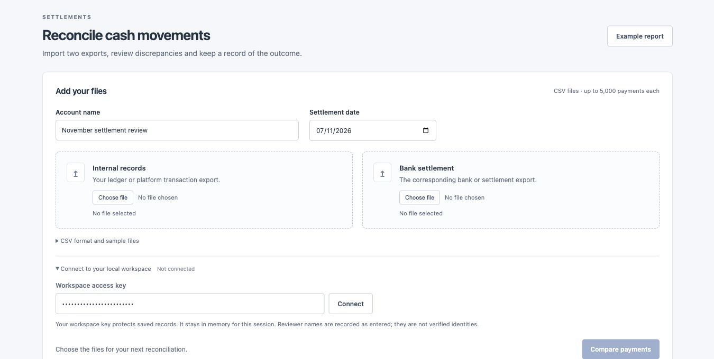
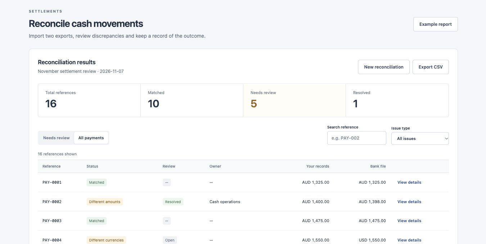
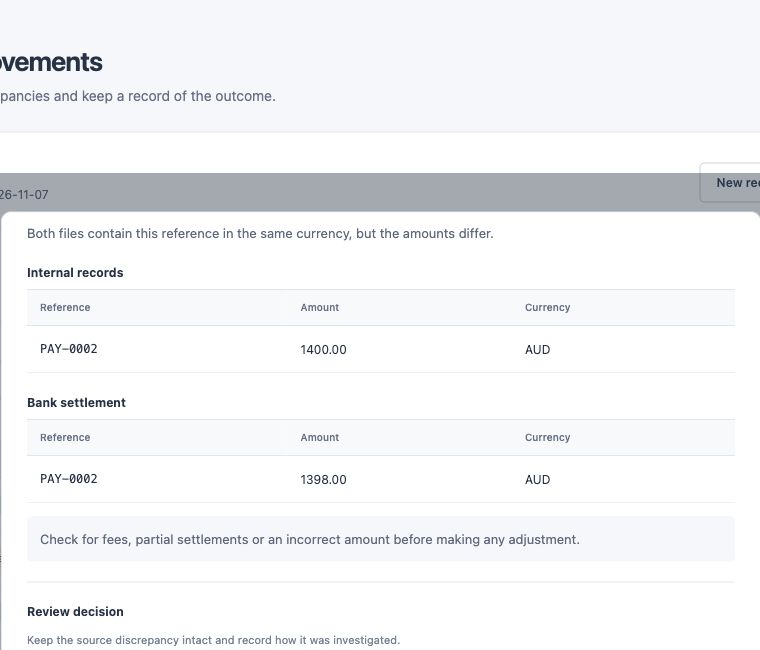
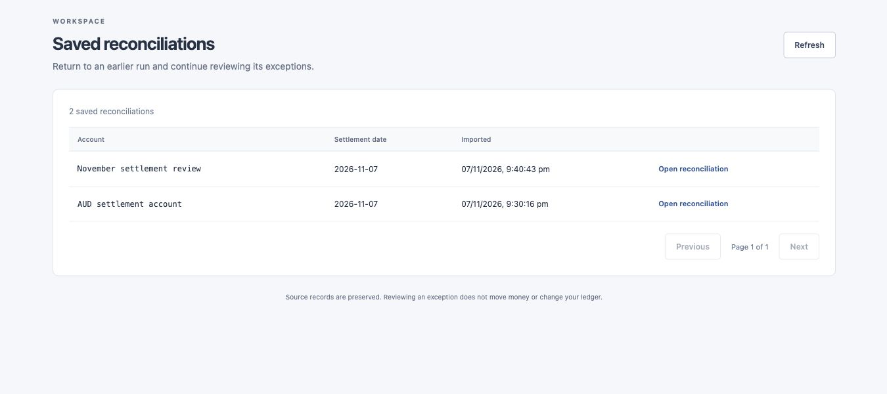
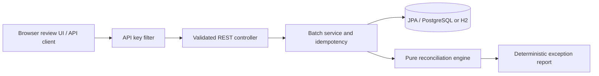

# LedgerMatch

A self-hosted workspace for reconciling internal cash records against settlement exports and tracking the exceptions through investigation and resolution.

## Who it helps

A cash operations analyst compares a ledger/platform export with a bank settlement export. Straightforward matches need no further work. The remaining items need an owner, an explanation and a record of the decision. Without that workflow, people can end up maintaining a separate spreadsheet or repeating an investigation the next day.

LedgerMatch keeps imported source records, the original matching report and reviewer updates together. It does not move money, correct a ledger or claim that a resolved discrepancy was an exact match.

## How it works

These screenshots use synthetic settlement records.

### 1. Import your exports

Choose an account and settlement date, then upload your internal records and the corresponding bank CSV. Map the reference, amount and currency columns and check the previews before comparing.



### 2. Review the comparison

See matching payments alongside missing records, amount or currency differences and duplicate references. Search by reference or filter by issue type. In this example, ten references match and one of the six exceptions has been resolved.



### 3. Investigate and record the outcome

Open a payment to inspect both source records. Assign an owner, add investigation notes and record a resolution reason. The original discrepancy stays intact, and each review update is retained in the activity history.



### 4. Return to saved work

Reopen a previous reconciliation to continue reviewing. Export CSV from the results to hand over payment rows with their review status, owner and latest note.



## Engineering

Java 17, Spring Boot, Spring Data JPA, Flyway, PostgreSQL/H2 and JUnit 5. Exact decimal comparison, signed credits/debits, idempotent ingestion, immutable report snapshots for new runs, optimistic concurrency for review decisions and append-only review events through the API. GitHub Actions tests against PostgreSQL and runs the CSV parser/export suite.

The matching engine is deterministic. No AI model is used to guess whether money matches.

## Run locally

Requires Java 17+. Maven is downloaded by the checked-in wrapper.

```sh
export LEDGERMATCH_API_KEY=local-demo-key-change-me
./mvnw verify
./mvnw spring-boot:run
```

Open **http://127.0.0.1:8080** and choose **Example report**. No access key is needed to view the read-only sample report.

For your own files, enter an account name and date, choose the ledger and bank CSVs, check the previews, and compare. Open **Connect to your local workspace** to supply the configured access key. Sample CSV downloads and a format guide are included in the form. Results support search, issue filters, payment details and CSV export.

Data is stored in `data/` (excluded from Git). The server key is required at startup, and the browser keeps it in memory only for the session.

### PostgreSQL and containers

Requires Docker Compose:

```sh
cp .env.example .env
# Replace the local-only example credentials in .env.
docker compose up --build
```

Compose waits for PostgreSQL readiness and binds the app to localhost. Flyway creates the schema; Hibernate validates it. The app container runs as a non-root user. To remove local database contents intentionally, use `docker compose down --volumes`.

## API example

```sh
curl -i http://127.0.0.1:8080/api/batches \
  -H "X-API-Key: $LEDGERMATCH_API_KEY" \
  -H 'Idempotency-Key: demo-settlement-001' \
  -H 'Content-Type: application/json' \
  --data-binary @examples/demo.json
```

A new batch returns `201 Created` and a `Location` header. Submit the same key and parsed payload again to receive `200 OK` with the original batch ID. Reuse the key with different content to receive `409 Conflict`. Keys are scoped to this single-tenant application.

| Method | Path | Purpose |
|---|---|---|
| POST | `/api/batches` | Validate, store and reconcile a batch |
| GET | `/api/batches/{uuid}` | Retrieve its reconciliation report |
| GET | `/api/batches?page=0&size=20` | Browse history; size 1–100 |
| GET | `/demo/report` | Public synthetic example, with no database writes |
| GET | `/actuator/health` | Public summary, with no database details |
| GET | `/actuator/prometheus` | Protected metrics including batch/exception counters |

All `/api/` requests require `X-API-Key`. POST also requires `Idempotency-Key` (1–100 letters, digits, dots, underscores or hyphens). See [API contract](docs/api.md) for the input shape, validation and outcome rules.

## Tests

```sh
./mvnw verify
```

By default tests use an isolated in-memory H2 database. CI sets `TEST_DATABASE_URL`, `TEST_DATABASE_USER` and `TEST_DATABASE_PASSWORD` to run the same integration suite against a PostgreSQL service. Run `node --test tests/csv.test.mjs` for the CSV import/export suite (Node 18+). It covers quoted fields, BOM/CRLF, duplicate preservation, validation, row limits and spreadsheet formula escaping. CI runs both suites.

Backend tests cover all six outcomes, currency priority, decimal precision, input validation, authentication, pagination, persistence, replay conflicts and concurrent retries.

## Architecture



A modular monolith keeps matching logic independent of HTTP and storage. There is no external bank connection or network dependency in reconciliation. New runs store an immutable report snapshot alongside the original submission. Reviewer decisions are separate from matching results. Legacy runs created before the snapshot migration retain the old recomputation fallback.

## Trade-offs and boundaries

- Exact, case-sensitive reference matching within one account/date batch. No fuzzy matching, partial settlements, FX conversion, fees, reversals or netting.
- Signed amounts, with two fractional digits maximum. Positive credits and negative debits must use the same convention in both files. Currencies with other minor-unit conventions are outside this demo's money model.
- A shared key controls access to a single trusted workspace; it is **not** user identity or account-level authorisation. Reviewer names are self-reported. It is unsuitable for real financial records in a public/multi-user deployment without tenant isolation, verified identity, HTTPS, key rotation, retention controls and access auditing.
- The request is synchronous and bounded to 5,000 entries per source. A large-file system would need streamed ingestion, background jobs and backpressure.
- Fingerprints use the serialised parsed submission. List order, account whitespace and decimal scale are significant for idempotency. Equivalent inputs reordered by the caller require a new key.
- Application metrics are process-local and reset on restart; they are not an accounting ledger. No production availability, load or security certification is claimed.

See [design decisions](docs/design.md), [operations notes](docs/operations.md) and the source tests for implementation details.

For a five-minute demo and code-reading guide, see the [walkthrough](docs/walkthrough.md).

## Workflow research

The design is informed by [Modern Treasury’s exception investigation and reconciliation history](https://docs.moderntreasury.com/payments/docs/manual-reconciliation) and [Stripe’s summary/itemised reconciliation reports](https://docs.stripe.com/reports/payout-reconciliation). These establish useful workflow patterns, not an integration or endorsement. [Macquarie Wrap’s public transaction guidance](https://www.macquarie.com.au/help/personal/macquarie-wrap-super-pension-investment/manage-your-account/balances-and-transactions-for-Macquarie-Wrap.html) provides domain context; this project has no connection to Macquarie systems.

## Development

Independent project built with AI coding assistance. See the tests, design decisions and walkthrough before relying on any claims. This is a working bounded reconciliation tool, not a certified accounting platform.
